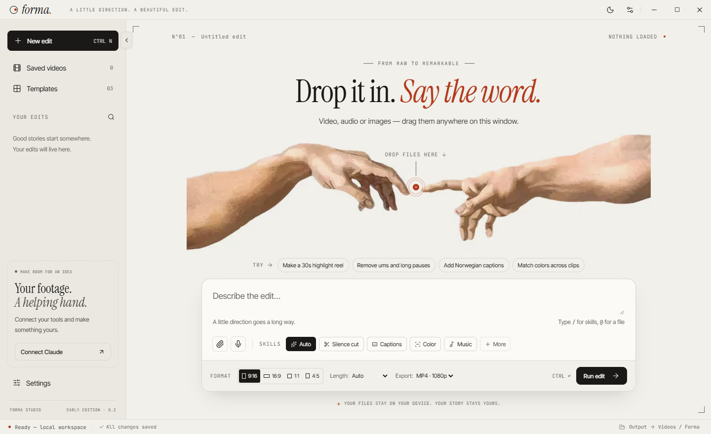
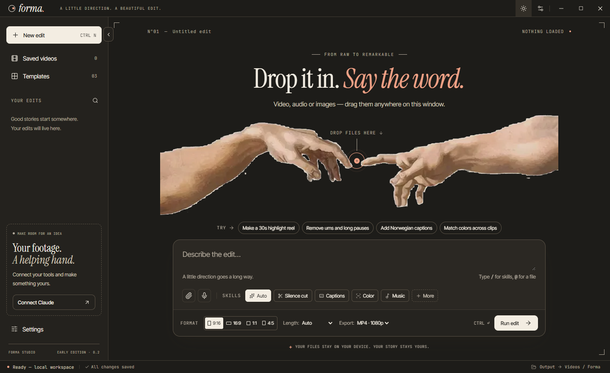
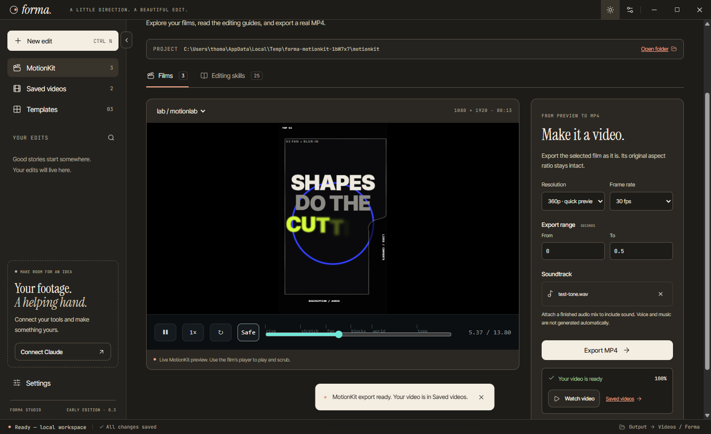

# Forma

A little direction. A beautiful edit.

A Windows and macOS desktop foundation for an approachable, prompt-driven video editor. Built with Electron, React and TypeScript, with warm paper colors, local typography and the supplied hands illustration. MotionKit is now integrated for live film previews, editing guides and native MP4 exports.



<details>
<summary>Dark mode preview</summary>



</details>

<details>
<summary>MotionKit studio preview</summary>



</details>

## What works today

- Native frameless window with minimize, maximize, close and single-instance handling.
- Light and dark modes using the sun/moon control in the title bar. Your choice is saved locally.
- A sliding sidebar: click the edge arrow, use Enter/Space, or drag it inward/outward. Its position is remembered between launches.
- Native file selection and whole-window file drop for video, audio and images.
- File metadata, duration when the codec supports it, source previews and removing attachments.
- Prompt composer, suggestions, `/` skill picker and `@` file mentions.
- Configurable skill registry, output aspect, target length and resolution.
- Templates, recent edit search, automatic local session/draft saving and restart recovery.
- Settings for Claude credentials, skills, export defaults, storage and shortcuts.
- API-key storage encrypted with Electron `safeStorage`; keys never enter saved projects or the renderer after saving.
- Claude Code account companion: native CLI discovery, browser sign-in, verified account status, cancellation, sign-out and a picker for custom installations. Credentials remain managed by Claude Code.
- Explicit, cancelable **demo mode**, producing an example edit plan.
- A real MotionKit studio with the three bundled example films, a live player, all 25 upstream editing guides, a project-folder picker and refresh after source edits.
- Native H.264 MP4 exports at 360p/720p/1080p/4K and 24/30/60 fps, with a selectable time range, optional AAC soundtrack, actual frame progress and cancellation.
- Finished exports in Saved videos, with playback, file reveal and recovery after restart.
- Automatic launch checks for stable Forma releases and the latest MotionKit commit on their public GitHub repositories, with an update indicator and Settings → Updates.
- Responsive layout, visible keyboard focus, modal focus management and reduced-motion support.

## What is intentionally pending

MotionKit previews and exports are real. The main editor's **Run edit** remains a separate, explicitly simulated prompt workflow. It does not automatically rewrite MotionKit films, inspect your footage, transcribe audio, cut silences, add captions or generate music. File previews depend on Electron's supported codecs; importing a MOV or MKV does not guarantee its codec can be previewed.

Automatic Claude execution, voice dictation and a timeline editor are pending. Claude Code account sign-in is available as a companion connection; it does not enable the demo prompt editor to make AI calls. A saved API key is not a verified connection. MotionKit's guides are readable in the app, and their supporting scripts are included in the working project; they are not automatically installed or executed. No footage is uploaded.

## Sign in through Claude Code

1. Open **Settings → Claude**. Forma looks for your native Claude Code installation in its usual location and on PATH. If it is missing, **Get Claude Code** opens Anthropic's installation instructions. **Choose Claude Code location** supports a custom installation.
2. If Claude Code already has a saved account, Forma displays its sign-in status. Otherwise choose **Sign in with Claude Code** and finish Anthropic's browser flow. Forma runs the installed CLI's `claude auth login --claudeai`; it does not implement its own OAuth client or collect tokens.
3. **Check status** reads `claude auth status --json`. Forma exposes only the account email, plan and authentication method. Credentials and refresh remain with Claude Code. A successful check describes the CLI's saved authentication status, not an end-to-end model request.
4. **Cancel sign-in** stops a pending login without signing out an existing account. **Sign out of Claude Code** explicitly logs out the shared CLI account, including its terminal sessions.

This companion uses your existing Claude Code installation and account configuration. It does not bundle Claude Code or reuse its OAuth tokens for API calls. Anthropic's [CLI reference](https://code.claude.com/docs/en/cli-reference) describes these commands. Automatic AI editing is a separate future integration, subject to Anthropic's supported authentication and permissions.

## MotionKit workflow

1. Choose **MotionKit** in the sidebar. On first use, Forma seeds a writable MotionKit project in its app data folder from the pinned source snapshot. Existing projects are preserved during upgrades.
2. Choose a film. The embedded upstream player supports playback, scrubbing, looping and safe-zone guides.
3. Choose **Editing skills** to read and search the actual upstream guides, including `motionkit`, `i-hate-editing`, captions, effects, editing, audio and finishing.
4. Use **Open folder** to edit the real project files, or **Choose project** to select an existing MotionKit checkout. Refresh reloads the film list and preview. Films retain MotionKit's deterministic `render(t)` and `window.PK` contract.
5. Choose a resolution, frame rate and time range, then **Export MP4**. Its authored aspect ratio is preserved. If you attach a soundtrack, it is aligned with the film timeline, padded or trimmed to the exported range, and muxed as AAC. Without an attached soundtrack, the export is silent; in-film browser audio is not captured.
6. Watch real frame progress or choose **Stop export**. An unfinished encode is removed rather than added to your library. A successful encode is checked with FFmpeg before its final filename and Saved videos record are created.

Forma uses Electron's bundled Chromium and a bundled FFmpeg executable for this path. It needs no system Node, Chrome, Python, FFmpeg or WSL when installed. Advanced upstream Python, voice, transcription and third-party workflows still have their own dependencies and are not part of the native film export path. External network assets are blocked in the sandboxed film renderer; keep a film's assets inside its project.

The native adapter also fixes the stage's grid sizing in served HTML, so the authored canvas stays centered in small previews and lower-resolution exports. It does not change the user's source files.

## Startup update checks

Both [Forma](https://github.com/Gonzolt/forma-editor) and [MotionKit](https://github.com/Gonzolt/motionkit) are public GitHub repositories.

Every application launch, including reopening the window on macOS, starts a background check:

- **Forma:** query GitHub's latest published, stable release and compare its semantic version with the installed app. Drafts and prereleases are excluded. **View Forma release** opens the official version's release page to download the appropriate installer.
- **MotionKit:** query the latest commit on the repository's default branch. Managed copies compare against their bundled base revision. Existing Git checkouts read their loose/packed/worktree HEAD without requiring a Git executable. A project with no readable revision is labeled untracked rather than up to date. **View MotionKit changes** opens the upstream commit history.

Results appear in **Settings → Updates**, with a title-bar indicator and one notification when a different version is found. **Check for updates** retries both checks. Cached ETags reduce repeated transfers; a 12-second network deadline, offline handling and rate-limit messages keep the editor available. Requests use public GitHub metadata; footage and credentials stay local.

Checks are read-only. Install the downloaded Forma release when ready. For MotionKit, review upstream changes and choose an updated project folder in the studio; working films are not overwritten automatically. The app checks sources and reports available versions, rather than silently installing code at startup.

## Publishing the next app version

Update `package.json` and its lockfile, commit the tested changes, then push a matching stable tag such as `v0.4.1`. `.github/workflows/release.yml` validates that the tag matches the package version, creates a draft release, tests/builds Windows x64 and both Mac architectures, uploads installers directly to that release, and publishes it after all builds succeed. Only published stable releases become the launch check's latest version. Regular branch builds continue to avoid publishing.

Installers remain unsigned/not notarized until platform signing is configured. Release installation is manual; no application binary is downloaded or executed by the update checker.

## Run locally

Use Node.js 24 and Git.

```sh
npm ci
npm run dev
```

Or build once and launch the desktop app:

```sh
npm run build
npm start
```

`npm run dev:web` opens the UI development server at `http://127.0.0.1:5173`. The browser preview supports file inputs and draft metadata; native dialogs, durable source-file access, OS encryption and window controls require Electron. Reimport browser files after reloading.

## Try the workflow

1. Attach media with the spark button, paperclip, `Ctrl/⌘ O`, or a file drop.
2. Click an attached file to preview it.
3. Write a brief or choose a suggestion. Select skills and an output format.
4. Choose **Run edit** (`Ctrl/⌘ Enter`). The first run switches on demo mode, which you can turn off again in Settings → Claude. Stop cancels the simulation. A completed demo creates an example plan and clearly states that no video was rendered.

## Build desktop packages

```sh
# Windows x64 installer, on Windows
npm run dist:win

# Apple Silicon, on macOS
npm run dist:mac -- --arm64

# Intel Mac, on macOS
npm run dist:mac -- --x64
```

Packages appear in `release/`. The GitHub Actions workflow tests and builds Windows x64, macOS Apple Silicon and macOS Intel. To download private workflow artifacts, run it manually with **Upload installers and screenshots** enabled; this requires available GitHub artifact storage. Routine push builds do not upload artifacts. It does not publish a release. The initial Windows installer is unsigned; macOS builds are not notarized. Public distribution should add platform signing credentials and notarization. A macOS build cannot be verified on Windows.

## Checks

```sh
npm test
npm run build
npm run test:desktop
npm run test:motionkit
npm run test:updates
npm run test:claude
```

Unit tests cover persistence, import registration, IPC state validation, the pinned MotionKit films/guides and project asset boundaries. Desktop smoke tests use isolated temporary profiles. They check the original editor and appearance controls, and additionally render actual MotionKit frames, reject empty black frames, decode the resulting H.264 MP4, test AAC soundtrack muxing, cancel an active render, play a finished export and restore the library after restart. Screenshots and a short rendered test film are saved in `test-results/`. No real credentials or AI calls are used.

## Where things live

- `src/components/`: TitleBar, Sidebar, Workspace/Hero, Composer, SettingsModal.
- `src/theme.css`: colors and font tokens. All fonts ship locally.
- `src/lib/skills.ts`: declarative skill and template registries.
- `src/lib/engine.ts`: isolated demo adapter; replace with the real planning/rendering service.
- `src/lib/bridge.ts` and `src/types.ts`: typed UI/desktop boundary and browser fallback.
- `electron/main.cjs`: native services and validated IPC handlers.
- `electron/preload.cjs`: narrow, context-isolated bridge. No arbitrary filesystem, shell or IPC access is exposed.
- `electron/media.cjs`: supported imports and stable file registration.
- `electron/store.cjs`: bounded state validation and serialized atomic writes.
- `electron/motionkit.cjs`: sandboxed offscreen Chromium frame rendering, FFmpeg jobs, cancellation and verified export history.
- `electron/kit-project.cjs`: project discovery, skill loading and constrained local asset serving.
- `electron/updates.cjs`: public GitHub release/commit checks, ETag cache, version comparison and Git revision reading.
- `vendor/motionkit/` and `vendor/UPSTREAM.md`: pinned original upstream source and provenance.
- `tools/prepare-ffmpeg.cjs` and `tools/before-pack.cjs`: install and package the encoder for the correct OS/CPU target, including Intel builds made on Apple Silicon.
- `.github/workflows/desktop.yml`: per-platform test and package jobs.
- `.github/workflows/release.yml` and `tools/release-assets.cjs`: stable tag validation and public release installers.

Local data uses Electron's per-user app data directory (`%APPDATA%/forma-editor` on Windows; `~/Library/Application Support/forma-editor` on macOS). Projects, registered source paths, output preferences, verified export history and encrypted credentials are separate files. The initial working MotionKit snapshot lives in the `motionkit/` subfolder; selecting an existing project stores its location instead. Source media stays where you imported it. Missing media is marked for reimport. Exports default to the operating system's video folder under Forma. No GPU capability is inferred or advertised.

## Next integration boundary

Connect an editing agent to the existing MotionKit working project and guides, keeping provider secrets in the main process. Replace `makeDemoPlan` with real planning/source-edit execution, then route its finished films through the existing MotionKit preview/export service. Validate a provider connection before displaying it as connected. The export service already exposes start, progress, cancel and verified output events; Saved videos contains actual checked outputs.

## Design assets

The hands image was supplied for this project. Fonts are bundled through Fontsource; their licenses ship with the respective packages. The minimal ring-and-dot app icon is reproducible with `tools/create-icon.ps1` on Windows. MotionKit's source and asset provenance is in `vendor/UPSTREAM.md`. The `ffmpeg-static` package includes its binary's license and build information, which ship alongside the unpacked encoder. The application has no analytics or remote font requests.
